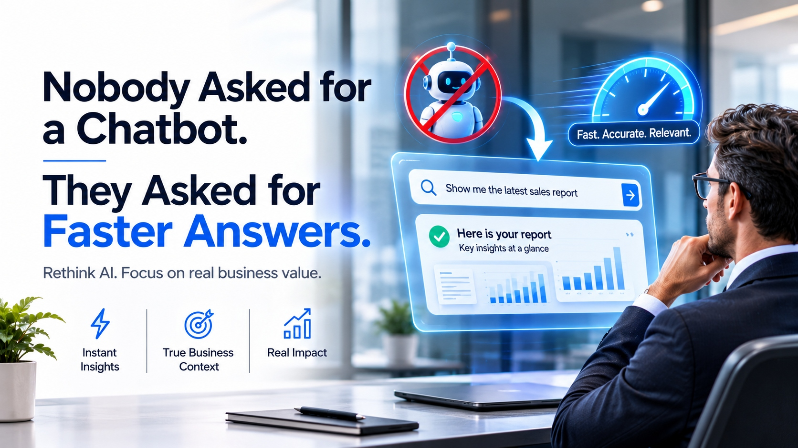
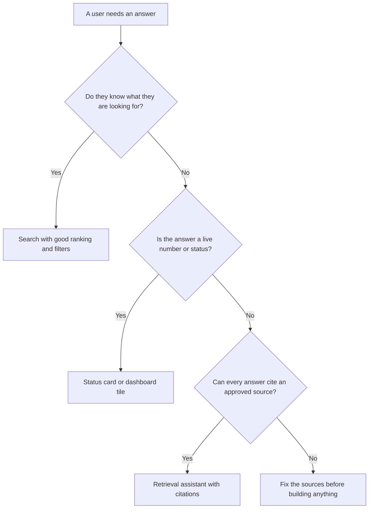

# Nobody Asked for a Chatbot. They Asked for Faster Answers.



*Rethink AI. Focus on real business value.*

---

> *Monday, 8:55 a.m. A sales director opens the company assistant and types: "Show me the latest sales report." The assistant replies: "Hello! How can I help you today?"*

Nothing is broken in that exchange. The model is capable, the interface is polished, and the demonstration went well. Yet the director has spent twenty seconds and gained nothing. What was wanted was a document. What was delivered was a greeting.

This is the quiet failure behind many AI features. They are built to be conversational when users want to be done. The more useful goal is to design [intelligent web apps](https://zignuts.com/ai-services/custom-ai-development/ai-web-application-development-services?utm_source=seo_web2.0&utm_medium=backlink&utm_campaign=seo_referral&utm_id=10) around the answer itself, so that the report, the clause, or the status appears in the fewest steps, with a visible reason to trust it.

What follows is a short field guide for leaders deciding what to build, and what not to.

## The Answer Gap

Every question has a cost, and most of it is invisible in a demonstration:

```
Cost of an answer  =  Time to reach it
                    + Effort to ask for it
                    + Doubt about whether it is right
```

A chatbot can lower the first and still raise the other two. Typing a careful question is effort. Reading a confident paragraph that cites nothing is doubt. The gap between the question and a *trusted* answer is what users experience, and it is the only number that matters.

## Choosing the Right Pattern

Before committing to a chat interface, walk the question through this path.



## Four Patterns That Often Beat a Default Chat Window

**1. Search that understands intent.**
*When:* users know the thing exists and want to reach it. *Why it works:* it removes the conversation entirely and returns the artifact.

**2. The live card.**
*When:* the answer is a number or a status. *Why it works:* it reads from the system of record, so it is current by design.

**3. The cited assistant.**
*When:* questions are open-ended and drawn from company knowledge. *Why it works:* every answer points to its source, which turns doubt into a quick check.

**4. The guided task.**
*When:* the work is routine and the steps are known. *Why it works:* AI drafts, checks, and routes, while the person confirms.

## What a Trustworthy Answer Looks Like

An illustrative example of the standard your users deserve:

```
Q:  What is the refund window for enterprise contracts?
A:  30 days from the invoice date.
    Source:    Enterprise Terms v4.2, section 6.1
    Status:    Matches the approved version
    Actions:   [ Open source ]   [ Report a problem ]
```

The pattern is simple: a direct answer, a source, a status, and a way to push back. Speed earns attention. Provenance earns reliance.

## Fast. Accurate. Relevant.

Three words from the banner above make a workable review standard.

- **Fast:** the user reaches a usable result in seconds, not after a dialogue.
- **Accurate:** the result is correct and can be traced to approved material.
- **Relevant:** the result reflects the user's role and business context, so it can be acted on.

A feature that meets only one of these is a demonstration. One that meets all three is a tool.

## Questions for Your Next Planning Meeting

1. What are the five questions our users ask most, in their own words?
2. For each one, what is the fastest path to a trusted answer?
3. Which of those paths needs a conversation, and which needs only a result?
4. Where does each answer come from, and who keeps that source current?
5. What happens when the system is unsure?

If the room cannot answer the first question, the interface is not the next decision.

---

**Build AI that answers, not just chats.** Explore how the team at [zignuts.com](https://zignuts.com/?utm_source=seo_web2.0&utm_medium=backlink&utm_campaign=seo_referral&utm_id=10) approaches it.
